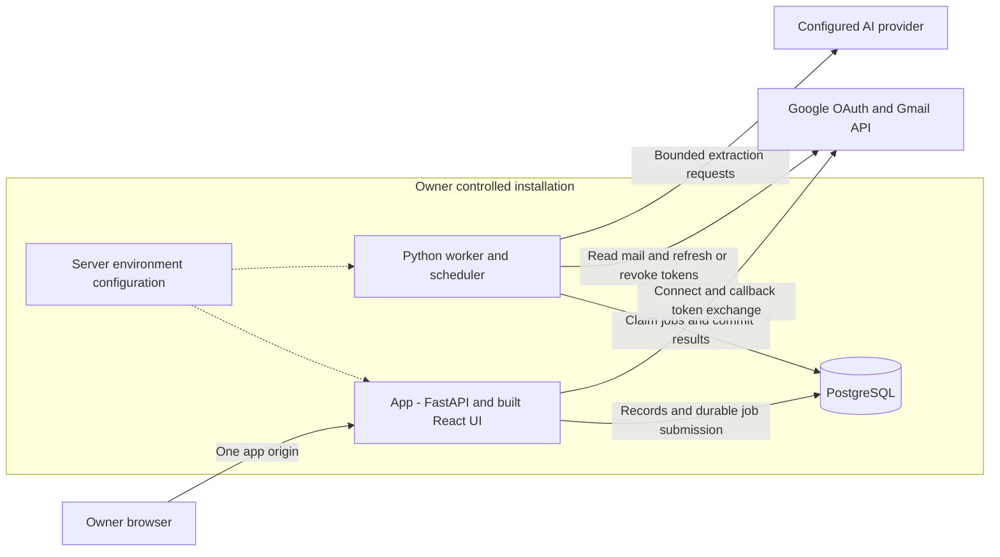
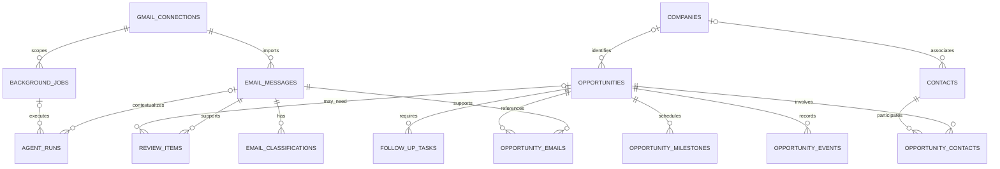
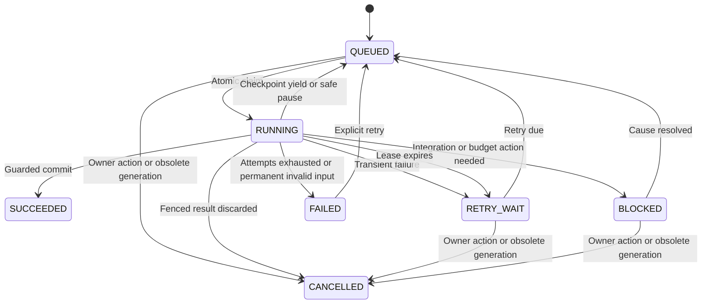
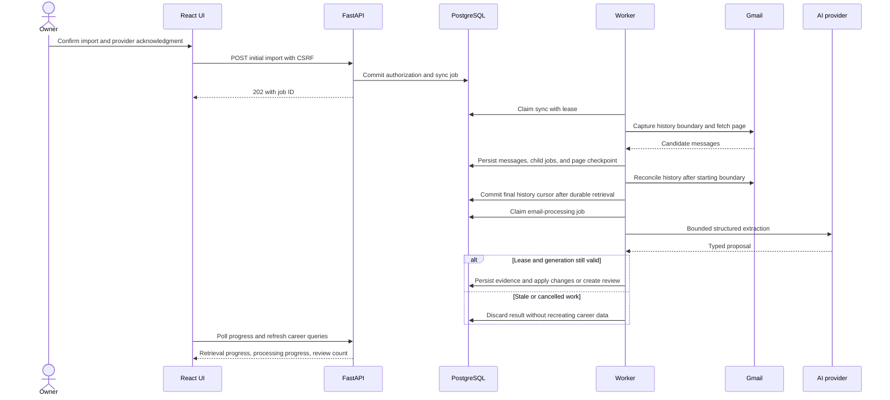
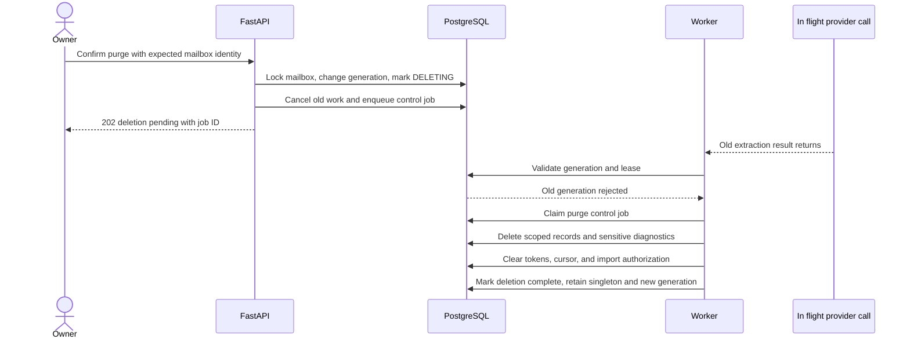

# Relayn Architectural Plan

Status: proposed implementation design based on [REQUIREMENTS.md](REQUIREMENTS.md). Application code has not been implemented. The build checklist, dependencies, and completion gates are in [DEVELOPMENT_PLAN.md](DEVELOPMENT_PLAN.md).

The requirements define product behavior. This document defines how to build it. Implementation details introduced here are design decisions, not claims that integrations or recovery paths have been tested.

## 1. Architecture decisions

| Decision | Implementation direction | Reason |
| --- | --- | --- |
| Repository | One monorepo with `frontend/` and `backend/` | Keep the UI, API, worker, migrations, and tests versioned together. |
| Frontend | React, TypeScript, Vite, React Router | Client-side authenticated productivity application. |
| UI and API state | Tailwind CSS, shadcn/ui, Lucide, TanStack Query | Reusable UI, typed requests, cache invalidation, and progress polling. Recharts follows the core workflow. |
| Backend | Python, FastAPI, Pydantic, SQLAlchemy, Alembic | One API/business-service layer and explicit data validation. |
| Database | PostgreSQL | Career records, durable work, coordination, and audit evidence in one transactional store. |
| Runtime | `app`, `worker`, and `db` Compose services | Keep HTTP responsive while imports and processing continue without a browser. |
| Queue and scheduler | PostgreSQL-backed jobs; scheduling inside one Python worker | Persist work without requiring Redis, Celery, or a separate scheduler. |
| Authentication | One environment-configured password, encrypted stateless cookie | No app accounts, users table, tenant filters, registration, or hosted auth. |
| Google integration | One Gmail mailbox; authorization-code flow and read-only scope | OAuth grants mailbox access independently of local login. |
| AI | Provider adapter, initially Gemini plus deterministic fixtures | Structured extraction and controlled decisions; no autonomous general-purpose tool runner. |
| Distribution | Build Vite assets into the app image; FastAPI serves assets and `/api` | One browser origin and no separate frontend runtime in the packaged installation. |
| Dependencies | `uv` and `pnpm`, committed lockfiles and pinned container/interpreter versions | Reproducible builds. Select supported stable versions during scaffolding rather than unpinned `latest` images. |

No remote hosting, real Google connection, paid AI usage, or application scaffolding is created by this planning step.

## 2. Runtime and deployment view



The browser never connects to PostgreSQL or receives OAuth tokens/provider secrets. The API and worker share backend modules, not HTTP calls between services. This is one modular application with two execution roles.

| Mode | Browser origin | Supporting processes | Exposure |
| --- | --- | --- | --- |
| Development | Vite at `http://localhost:3000` | FastAPI on loopback port 8000, Python worker, PostgreSQL | Vite forwards `/api` to FastAPI. A development-only database port, if needed, binds to loopback. |
| Packaged local installation | `http://localhost:3000` | `app`, `worker`, `db` | Map `127.0.0.1:3000` to the app container's port 8000. Do not publish database or worker ports. |
| Owner-hosted server | Owner's HTTPS origin | Same application services behind the owner's TLS proxy | Trust forwarded headers only from that proxy; expose only the app origin. |

Register API routes before static assets and the SPA fallback. Unknown `/api/*` paths return JSON `404`, never `index.html`. Serve only known UI routes through the fallback; missing asset files return `404`. Vite's proxy is development-only, and FastAPI's static serving is the packaged path. See [Vite server options](https://vite.dev/config/server-options.html#server-proxy) and [FastAPI static files](https://fastapi.tiangolo.com/tutorial/static-files/).

Startup order is database readiness, a one-shot migration command using the app image, then app and worker. Migrations are a release step, not a second scheduler or a migration race on every process startup. A schema-version mismatch stops a process with an actionable error.

## 3. Repository layout and module ownership

The following is the target layout to create during implementation. Only the planning documents currently exist.

```text
relayn/
  REQUIREMENTS.md
  ARCHITECTURE.md
  DEVELOPMENT_PLAN.md
  README.md
  .env.example
  .gitignore
  .dockerignore
  Dockerfile
  compose.yml
  compose.dev.yml
  .github/workflows/ci.yml
  frontend/
    package.json
    pnpm-lock.yaml
    vite.config.ts
    src/
      app/                 # Router, session bootstrap, providers, layout
      components/          # Shared controls and evidence/timeline views
      features/            # Opportunities, review, follow-ups, settings
      lib/                 # API client, query keys, formatting
      types/               # Generated API types, not secret configuration
    tests/
  backend/
    pyproject.toml
    uv.lock
    alembic.ini
    migrations/
    app/
      main.py              # FastAPI factory and packaged asset serving
      worker.py            # Worker process entry point
      cli.py               # Password/secret generation and operational commands
      core/                # Validated configuration, clock, errors, logging
      auth/                # Passwords, sessions, CSRF, OAuth request binding
      db/                  # Sessions, transaction helpers, migration readiness
      models/              # SQLAlchemy models and constraints
      schemas/             # Public DTOs and validated extraction/proposals
      api/                 # HTTP routes and authentication dependencies
      services/            # Shared domain operations and read queries
      integrations/
        gmail/             # Google client and synthetic mailbox gateway
        llm/               # Gemini and deterministic fixture adapters
      jobs/                # Claims, leases, scheduler, dispatch, handlers
    tests/
      unit/
      integration/
      fixtures/
      evaluation/
  e2e/                     # Playwright critical user journey
```

| Boundary | Owns | Must not own |
| --- | --- | --- |
| `api/` | HTTP validation, session/CSRF checks, service calls, DTO responses | Gmail import loops or business rules duplicated from the worker. |
| `services/` | Matching, state changes, review resolution, follow-ups, purge policy | Browser/session state or unrestricted model-generated SQL. |
| `jobs/` | Scheduling, durable execution, retry and lease policy | A second implementation of extraction or opportunity mutation. |
| `integrations/` | Bounded Gmail/AI requests, response conversion, typed errors | Committing career records or deciding whether to override corrections. |
| `schemas/` | Typed inputs, structured extraction, proposals, API outputs | SQLAlchemy entities exposed directly to the browser. |
| Frontend | Owner actions, presentation, query invalidation, progress polling | Token storage, provider calls, authoritative state transitions. |

Use explicit service functions and transactions; do not introduce a generic repository framework or an event-bus infrastructure. The API and worker call the same mutation functions with an execution context describing owner action or a leased job.

Use SQLAlchemy's synchronous ORM with Psycopg 3 initially. Blocking route handlers run in FastAPI's threadpool; the worker runs blocking handler work separately from its scheduler/heartbeat loop. Each request/job/heartbeat owns its own session, with a small bounded SQLAlchemy connection pool per process. No PgBouncer service or async-ORM rewrite is required for the single-owner MVP. Size the combined app/worker pools below the PostgreSQL connection budget and set bounded acquisition/statement/lock timeouts. See [SQLAlchemy pooling](https://docs.sqlalchemy.org/en/20/core/pooling.html) and its [Psycopg dialect](https://docs.sqlalchemy.org/en/20/dialects/postgresql.html#module-sqlalchemy.dialects.postgresql.psycopg).

## 4. Functional components to develop

| Component | Responsibilities | Concrete output |
| --- | --- | --- |
| Configuration and CLI | Validate environment, generate hash/keys, identify real versus demo mode | Settings model, interactive CLI, `.env.example`. |
| Local authentication | Password check, encrypted sessions, login throttling, CSRF | Auth routes/dependencies and protected UI bootstrap. |
| Gmail authorization | One-time state, PKCE, token exchange, mailbox identity, encryption | Connect/callback/disconnect flow and setup UI. |
| Mailbox gateway | List candidates, read messages/threads, read history, fake equivalent | Real and fixture gateways behind one interface. |
| Sync coordinator | Import pages, checkpoint, reconcile history, persist processing work | Initial/incremental handlers with progress. |
| Job engine | Schedule, deduplicate, claim, heartbeat, retry, resume, cancel | Worker command and job/status APIs. |
| Processing pipeline | Normalize text, classify, extract, match, validate, propose | Versioned structured results and reusable evidence. |
| Career record service | Apply validated changes and compute current projections | Companies, contacts, opportunities, timeline, milestones. |
| Review service | Resolve ambiguous or conflicting changes with evidence | Review queue and protected corrections. |
| Follow-up engine | Track obligations, silence rules, deadlines, completed/dismissed actions | Deterministic refresh and follow-up views. |
| Briefing/read queries | Aggregate structured data, filters, metrics, local-day views | Dashboard and on-demand briefing. |
| Lifecycle/operations | Fence deletion, clean diagnostics, surface failures, backup/restore | Control jobs, status UI, documented operational commands. |
| Assistant, stretch | Read-only, bounded record tools and local draft text | Optional assistant screen after the core passes. |

## 5. Data model and integrity

Use the logical fields in REQUIREMENTS.md as the migration baseline. The following relationships and constraints are implementation requirements; the diagram omits diagnostic columns for readability.



### Records and constraints

| Records | Rules and indexes |
| --- | --- |
| `gmail_connections`, `app_settings` | `CHECK (id = 1)` singleton rows; Gmail row persists across disconnect and purge. A fresh random `processing_generation` changes on disconnect/purge/replacement. Never reset it to a previously used value. Add an immutable initialized `data_mode` setting (`real` or `demo`) and reject mismatched process configuration. |
| `email_messages` | Unique `(gmail_connection_id, gmail_message_id)`; index thread ID and sent time. Gmail IDs/history IDs are strings, not locally incremented counters. Track normalized input fingerprint, relevance/processing state, and source availability. Nullable text permits discarding rejected unrelated content. |
| `email_classifications`, `agent_runs` | One category per message/result version; structured extraction can live in the result JSONB. Record input fingerprint, model, prompt, pipeline versions, and successful/failed status. Add a unique result identity for cache reuse. Retain minimal run/version provenance after verbose diagnostics expire. |
| `companies`, `contacts` | Nullable incomplete fields. Canonical domain/name keys and normalized contact email support matching; do not make company name or generic mail-provider domains proof of identity. Keep original display values. |
| `opportunities` | Index type/status, company, last activity, and application date. Add integer `version` for optimistic concurrency. Keep field provenance/manual protection separately from current field values. No unique company/title constraint: distinct openings can share both. |
| `opportunity_contacts`, `opportunity_emails` | Unique relationship pairs; partial unique index for one primary contact per opportunity. Preserve original source IDs. |
| `opportunity_events` | Append-only ordinary writes, source/semantic-event idempotency key, effective time versus recorded time, confirmed/inferred/manual evidence. Manual corrections may have no source email. Purge is the explicit exception to append-only history. |
| `opportunity_milestones` | Distinguish UTC instant, date-only value, and unresolved text. A stable source/milestone key prevents duplicate interview/deadline records. Preserve rescheduling history through events. |
| `review_items` | Unique proposal identity for message/evidence and proposed change; index pending status and creation time. `opportunity_id` is nullable before creation. Resolution retains decision, evidence, expected record version, and timestamp. |
| `follow_up_tasks` | Stable recommendation key and source obligation identity; index status/due date. Completion/dismissal survives refresh; new evidence can create a genuinely new obligation. |
| `background_jobs` | Due-job and expired-lease indexes; active sync uniqueness across queued/running/retry/blocked states. Processing result identity prevents repeated child work. Payloads contain references/options, never email copies or credentials. |
| `worker_heartbeats` | One row per running worker instance; `current_job_id` is nullable and not a cascade owner of job history. |
| `login_throttle` | Atomic per-IP and global counters; indexed expiry cleanup. No owner password, email, or account row. |
| `oauth_requests` (small schema refinement) | Hashed random state, session-binding fingerprint, encrypted PKCE verifier, expiry, and consumed status. Allows one-time callbacks without creating users or server-side login sessions. Cleanup expired requests. |

Store timestamps as timezone-aware PostgreSQL timestamps; use a date column for date-only milestones. Use UUIDs for domain/job identifiers and generation values. Do not add `user_id`, `tenant_id`, or a dummy users row.

Index foreign keys used by detail reads, reassociation, and purge, including reverse sides of junction tables when their primary-key order does not cover that lookup. Use partial indexes for due/active jobs and pending reviews with predicates matching the actual queries. Paginate timelines/lists with stable keyset cursors containing all sort fields plus the unique ID; do not depend on deep OFFSET scans. Review query plans using representative synthetic data during implementation, rather than adding broad JSONB indexes speculatively.

Foreign keys from source evidence to disposable job diagnostics must not delete domain data on diagnostic cleanup. Keep minimal `agent_runs` provenance or nullable diagnostic links. For mailbox purge, delete scoped evidence and derived data deliberately in dependency order, preserving installation/authentication settings.

### State projection and manual corrections

Current opportunity status and fields are projections over validated evidence and owner decisions. Store `event_date` separately from `recorded_at`. An older email can add historical evidence without reverting a newer status. A later-stage number is not a sufficient ordering rule: interview and assessment order can vary.

When a recruiter lead receives formal submission evidence, record a type transition to `APPLICATION` and the application date; do not create a duplicate application merely to move it to the Applications screen. Never infer a submitted application from a resume exchange alone.

Manual field changes become explicit correction events and protected provenance. Conflicting later extraction creates review work. On reassociating an email, append a correction, update the current relationship, and recompute affected projections in one transaction; preserve the original audit trail. Accept/edit actions validate the latest `version`; outdated proposals return `409` and refresh their evidence instead of overwriting newer data.

## 6. Local login and Gmail connection

### Password and session implementation

Use `argon2-cffi` to generate and verify Argon2id hashes. Use `cryptography` Fernet for authenticated encrypted opaque session payloads and separately encrypted stored Google credentials. Derive purpose-specific session/CSRF/fingerprint keys from the high-entropy session root using HKDF; never derive Google-token encryption from the password. These are library primitives, not a custom encryption algorithm. See [Argon2 password hashing](https://argon2-cffi.readthedocs.io/en/stable/) and [Fernet encryption](https://cryptography.io/en/latest/fernet/).

The session payload contains fixed identity `owner`, issued/expiry timestamps, persistence choice, a random session nonce, and a keyed fingerprint of the configured password hash. Validate its authenticated envelope, payload types, expiry, and current fingerprint on every private API call. Enforce 24-hour/30-day lifetimes, HttpOnly/host-only/SameSite=Lax cookies, and HTTPS Secure cookies outside loopback development. Logout clears the cookie; password/session-root rotation invalidates all sessions. No database session row or per-session revocation guarantee is introduced.

Use a signed, browser-bound CSRF bootstrap for login and a session-bound CSRF token after sign-in, validated together with the configured Origin on mutations. Rotate the bootstrap/session binding on login. Do not put passwords in URLs, record cookies in logs, or trust arbitrary forwarded IP headers. Persist the required per-IP/global throttle atomically, returning `429` and `Retry-After` when blocked. Settings returns only whether secrets are configured, never their values.

Password generation is interactive, using a documented representation that survives Python `.env` loading and Compose interpolation. Verify the exact hash value through both launch paths; do not rely on quoting assumptions around `$` characters. Generate session and token keys independently.

### Gmail authorization sequence

1. Authenticated owner POSTs a connect action with CSRF protection. Persist a random, session-bound, short-lived OAuth request and PKCE verifier; return the Google authorization URL.
2. Request only `gmail.readonly`, offline access, and the exact registered callback URI. Use `google-auth-oauthlib` for the web-client authorization flow and PKCE, and `google-auth`/the Gmail client for authorized API requests. The library supports an explicit/generated code verifier; see its [flow reference](https://google-auth-oauthlib.readthedocs.io/en/latest/reference/google_auth_oauthlib.flow.html).
3. The callback requires the same valid local session and a matching unexpired request. Atomically consume the state so retries/replays cannot exchange it twice. Exchange the code outside a database transaction, validate granted scope, and obtain the mailbox address through Gmail's profile API.
4. If this is the same mailbox or an empty installation, persist encrypted credentials. A different mailbox is rejected with instructions to use the explicit purge/replacement flow; do not silently rebind retained data.
5. Show provider disclosure, time-zone selection, lookback, and an explicit initial-import confirmation. Connecting Google alone does not authorize importing or sending text to AI.
6. Persist acknowledgment and initial-import authorization together with the initial sync job. Later logout does not stop this persisted authorization.

Keep raw access tokens in process memory where possible. Persist the refresh credentials encrypted and preserve a previous refresh token if a refresh response omits it. Serialize credential updates and check generation before saving refreshed tokens. Revocation/missing scopes block retrieval and surface reconnection; they do not invalidate the app login.

## 7. Background job design

### Job types

| Type | Trigger | Handler responsibility |
| --- | --- | --- |
| `SYNC_INITIAL` | Confirmed first import, lookback extension, or expired-history recovery | Candidate pages, thread retrieval, initial boundary, and catch-up reconciliation. |
| `SYNC_INCREMENTAL` | Due polling time or explicit sync | Drain Gmail history from the committed cursor. |
| `PROCESS_EMAIL` | New/changed candidate persisted | Structured processing and a validated mutation/review proposal. |
| `REPROCESS_EMAIL` | Owner-requested versioned replay | Reuse valid results where appropriate and preserve corrections/events. |
| `REFRESH_FOLLOW_UPS` | New evidence/correction or periodic due-date tick | Recompute obligations without recurring LLM calls. |
| `DISCONNECT_MAILBOX` | Owner disconnect request | Attempt revocation, clear tokens, finish a fenced disconnect. |
| `PURGE_MAILBOX` | Confirmed data deletion or replacement preparation | Remove scoped data and sensitive execution fragments after fencing. |
| `CLEAN_OPERATIONAL_DATA` | Daily worker maintenance | Expired OAuth requests/throttles/diagnostics and old heartbeat rows. |

On-demand dashboard/briefing reads are database queries, not periodic AI jobs. The optional assistant is specified separately in Section 10.



### Scheduler, claims, and fairness

One worker process owns a small scheduler loop and bounded job execution. Keep heartbeat/lease renewal on an independent loop so a 120-second provider request cannot make a healthy worker appear dead. Use separate database sessions per execution context and avoid sharing a mutable Google HTTP client across concurrent threads.

Starting operational defaults: scheduler wake-up every five seconds, worker heartbeat every fifteen seconds, stale health after sixty seconds, and a two-minute renewable job lease. These are proposed operational constants to validate in tests, not external API guarantees. Renew leases while network work is active; a lost lease stops commit even if the request eventually returns.

The scheduler atomically inserts one due sync and updates `next_sync_at`. Active sync uniqueness prevents initial and incremental jobs for the same generation from overlapping. After downtime, coalesce missed ticks into one sync. Auto-sync activates only after initial authorization and applicable AI acknowledgment.

Claim a due eligible job with `FOR UPDATE SKIP LOCKED`, write a fresh lease token/owner/expiry, and commit immediately. PostgreSQL explicitly supports skipping locked rows for queue-like consumers; use short transactions. See [PostgreSQL SELECT locking](https://www.postgresql.org/docs/current/sql-select.html).

Process bounded message/page batches and yield persisted checkpoints. Yielding a large import must allow email processing/control jobs to run so the UI can show opportunities before all historical pages finish. Normal progress yields do not consume the failure retry budget. Do not repeatedly prioritize a blocked message over every other job.

At every domain commit, use a consistent lock order: mailbox connection, job, then affected opportunity rows in stable ID order. Verify current generation, permitted connection state, and live lease token before writing. API corrections use the same mailbox/record ordering and record versions. Network calls happen outside those locks.

### Retry, pause, and cancellation policy

- Classify errors as transient retryable, blocked pending configuration/reconnection/budget, invalid per-message data, or permanent failure. Respect provider `Retry-After`; otherwise use exponential backoff with jitter and an initial five-attempt limit.
- Expired leases are failed attempts eligible for recovery, never evidence that the previous process cannot return. Lease-token and generation checks fence late commits.
- Store idempotency identities by generation/message/input/pipeline and semantic domain event. Never claim exactly-once provider calls or billing: a crash after a provider response can repeat a request.
- Pause excludes automatic retrieval and queued mailbox processing from claims; in-flight operations checkpoint and yield before the next mutation. A manual one-off sync gets an explicit run ID and pause override inherited only by its child processing jobs. It does not unpause unrelated backlog or enable auto-sync.
- Disconnect/purge control jobs bypass mailbox pause. They still need their current control-operation generation and valid lease; ordinary processing is prohibited in disconnecting/deleting states.
- On graceful shutdown, stop new claims and checkpoint/release work. On crash, recover through lease expiry. Repeated owner commands return the existing active job where the operation is already scheduled.

## 8. Gmail retrieval and processing flows

### Initial and incremental synchronization



Initial import algorithm:

1. Capture `H0` from Gmail's profile at the start. Persist search/lookback, phase, page token, and starting boundary in the job checkpoint.
2. Search for candidates within the lookback; fetch relevant native threads so keyword-free replies are included. Normalize MIME/HTML into safe text; do not fetch attachments, remote images, or arbitrary email links.
3. Per page/batch, upsert messages, insert deduplicated processing jobs, and save the page checkpoint in one guarded transaction. Yield between bounded batches. If a page token expires, restart candidate enumeration with deduplication.
4. Drain mailbox history from `H0` to catch changes that arrived during enumeration. Persist all observed message changes or an explicit unavailable-source outcome. If a history boundary expires, restart a bounded full reconciliation safely.
5. Advance the connection's committed history cursor only when the corresponding history pages and affected retrieval outcomes are durable. `last_sync_at` means retrieval success, not that every AI job succeeded.

Incremental import drains `history.list` from the last committed cursor, fetches changed messages/known threads, and uses the same upsert/child-job path. The History API is not a keyword-search endpoint; apply candidate discovery and known-thread checks to changes instead of assuming it accepts the initial search query. Do not permanently store or send the entire unrelated inbox to AI.

An expired cursor returns `404` and needs full synchronization, as documented by [Gmail](https://developers.google.com/workspace/gmail/api/guides/sync). Treat its history identifiers as opaque provider values; do not increment them locally. A temporary transport/permission failure is not proof that a message was deleted: only a confirmed absent/deleted source changes `source_available`.

### Processing pipeline

| Step | Input | Output and write policy |
| --- | --- | --- |
| Normalize | Stored candidate and relevant thread context | Safe text, participants, direction, timestamps, input fingerprint. Preserve original address forms; do not merge different addresses by Gmail dot/plus assumptions. |
| Relevance/classify/extract | Bounded context and versioned prompt | Pydantic result: relevance, categories, entities, obligations, milestones, confidence, evidence spans. One structured call can perform these capabilities initially. |
| Reuse/validate | Result or matching persisted result | Reject malformed output; validate evidence, dates, enum values, and missing/null fields. An unrelated result creates no career records; discard unnecessary body content while retaining minimal dedup/relevance metadata. |
| Resolve | Extracted entities plus existing records | Deterministic candidates by thread/contact/domain, then title/context similarity. Ambiguity produces review rather than a forced merge. No vector store is required. |
| Propose | Validated extraction and selected existing records | Typed `OpportunityChangeSet` carrying evidence, expected record versions, and semantic event keys. Model output cannot call persistence directly. |
| Apply or review | Change set, lease, generation, current records | Transactional mutation for supported high-confidence changes; otherwise review items. Record manual conflicts and chronological ordering. |
| Derive | Newly committed evidence/events | Refresh follow-ups and milestones idempotently; invalidate UI queries on the next progress refresh. |

Company/contact matching must distinguish a recruiter's agency from the hiring company. Same company/title or a shared Gmail thread alone is insufficient when multiple openings are discussed. Application confirmations, explicit submissions, and newer direct status evidence are stronger than generic company mentions. Review thresholds are configurable heuristics, not measured accuracy claims.

### Provider interface and usage control

Implement `LLMProvider.extract_email(context, schema, limits)` and a fixture equivalent returning the same schema. Pass source IDs/evidence and relevant text only, with timeouts and input/output limits. Record provider/model/prompt/pipeline versions and truncation metadata. Missing configuration blocks real AI work; synthetic output is only valid in an explicitly isolated demo installation.

Reserve request budget in a short transaction before calling the provider, then settle provider-reported usage on completion. Extend minimal run metadata with reservation and UTC usage-day fields if a daily ceiling is configured. With missing usage information, retain a conservative reservation/estimate and label it; this is an app processing limit, not guaranteed billing enforcement. The same limiter must apply to future interactive assistant calls. In-flight calls may finish after the limit is reached. Do not log full prompts or raw responses containing entire email bodies.

## 9. Review, follow-ups, and deletion flows

### Owner review

Pending review shows current values, proposal, evidence, and why the system is uncertain. Accept/edit/dismiss uses a protected endpoint with expected review/record version. The service locks relevant rows, revalidates current state, applies accepted changes, appends an owner decision event, and resolves the proposal atomically. A second click returns the already-resolved outcome; stale conflicting decisions return `409`. Dismissal suppresses the same proposal identity until genuinely new evidence exists.

### Follow-ups and milestones

Extraction identifies obligations and who owes a response; deterministic code evaluates due dates and elapsed silence. No response-required evidence means no automatic overdue flag. Periodic time checks must work without new emails. Task identity includes the source obligation so completion/dismissal survives refresh. A new recruiter request after task completion can become a new obligation.

Keep exact instants in UTC, date-only deadlines as dates, source time-zone text as evidence, and ambiguous expressions unresolved. Display in the owner's IANA zone. The daily briefing groups structured data by the owner's local date; the optional AI usage ceiling uses documented UTC accounting days independently.

### Fenced disconnect and purge



Disconnect follows the same first fencing step, attempts Google revocation outside locks with a timeout, clears credentials even when revocation cannot be confirmed, and preserves career records. Purge also removes career data, review evidence, caches, and sensitive execution fragments. When a purge includes disconnect, attempt revocation before token removal and report the outcome. Process purge in restartable batches if needed; the operation is complete only after scoped removal finishes. Show pending deletion if the worker is unavailable, never a false success.

Preserve authentication, preference configuration, and the non-reused mailbox generation. Clear initial-import authorization, cancel old work, and require new confirmation before reading mail again. A replacement connection is allowed only after the old purge completes. Old backups are owner-managed and are not modified by a live purge; restoring one can restore old records.

## 10. HTTP contracts and frontend screens

All routes below use `/api` so the required `/api/gmail/callback` remains exact. Private routes require the owner session; state-changing routes also require CSRF and Origin validation. API DTOs never serialize credentials or ORM objects wholesale.

| Routes | Contract |
| --- | --- |
| `GET /health/live` | Minimal public liveness response; no configuration or database details. |
| `GET /auth/csrf`, `POST /auth/login` | Browser-bound CSRF bootstrap and password-only login with persistence choice. Login is public but protected against CSRF and rate-limited. |
| `GET /auth/session`, `POST /auth/logout` | Session metadata/CSRF refresh, or `401`; logout clears cookies. |
| `GET /settings`, `PATCH /settings` | Sanitized preferences, integration flags, timezone, provider acknowledgment state. No secret values or environment-secret mutation. |
| `POST /settings/ai-acknowledgment` | Persist acknowledgment for the current server-configured destination/notice version, not an arbitrary browser-supplied provider. |
| `POST /gmail/connect`, `GET /gmail/callback` | Start OAuth, then validate session/state and exchange code. Callback uses OAuth state rather than mutation CSRF. |
| `GET /gmail/status`, `POST /gmail/disconnect` | Connection/mailbox identity and durable fenced disconnect. |
| `POST /gmail/import` | Confirm lookback, mailbox, and provider disclosure; persist authorization and enqueue initial sync. |
| `POST /sync`, `POST /sync/pause`, `POST /sync/resume` | One-off sync or persisted processing controls. Return effective mode and existing/new job ID where applicable. |
| `GET /jobs`, `GET /jobs/{id}`, `POST /jobs/{id}/retry` | Paginated sanitized job metadata/progress; retry only eligible failed/blocked work after cause resolution. Do not return raw payloads/checkpoints. |
| `GET /system/status` | Authenticated database readiness, heartbeat/staleness, queue counts, and integration health. |
| `GET /opportunities`, `GET /opportunities/{id}` | Filtered applications/leads plus typed details, provenance, and record version. |
| `PATCH /opportunities/{id}` | Allowlisted manual fields/status with expected version; append correction evidence. |
| `GET /opportunities/{id}/events`, `/emails`, `/milestones` | Paginated chronological source references and structured dates. Each suffix follows the opportunity ID. |
| `POST /emails/{id}/association`, `POST /emails/{id}/reprocess` | Correct an email association or request versioned reprocessing through validated services. |
| `GET /emails/{id}`, `GET /contacts`, `GET /contacts/{id}` | Safe imported text and contact/relationship data, with bounded pagination where appropriate. |
| `GET /review-items`, `POST /review-items/{id}/resolve` | Evidence, proposed/current values, and idempotent accept/edit/dismiss decision. |
| `GET /follow-ups`, `POST /follow-ups/{id}/resolve` | Filtered tasks and completion/dismissal state. |
| `GET /overview`, `GET /briefing` | Structured aggregates and on-demand briefing; no automatic model call on every dashboard render. |
| `POST /data/purge` | Explicit mailbox confirmation, immediate fencing, `202` with control job. Normal API controls cannot bypass the fencing service. |

`/health/live` in the table is `/api/health/live`, and similarly for all other listed paths. A `POST /demo/import` route may enqueue fixtures only when the server is already configured in demo mode; it never switches a real-data process to demo or grants authentication.

Use `202 {job_id, status, reused, status_url}` for asynchronous commands. Use stable error bodies `{error: {code, message, request_id, retry_after_seconds?}}`; meaningful cases include `401` authentication, `403` CSRF/origin, `409` stale version/invalid lifecycle, `422` invalid input, and `429` throttling. Lists accept bounded `limit`/cursor and allowlisted filters/sorts. Start with a limit of 50 and a maximum of 100. Build typed frontend DTOs from FastAPI OpenAPI and check drift in CI.

| Screen | Must deliver | Implementation dependencies |
| --- | --- | --- |
| Login/setup | Password form, CSRF/session bootstrap, timezone and integration setup | Auth/config APIs. |
| Overview | Core counts, recent events, pending actions, on-demand briefing | Read projections; charts are stretch. |
| Applications and leads | Shared list/table with type-specific filters and detail links | Opportunity queries; one canonical opportunity model. |
| Opportunity detail | Timeline, safe email evidence, contacts, milestones, manual changes | Related read APIs and corrections service. |
| Contacts | Basic list/detail and linked opportunities | Many-to-many contact relationships. |
| Follow-ups | Evidence, due dates, complete/dismiss | Deterministic follow-up engine. |
| Review | Pending proposals, evidence, accept/edit/dismiss | Review service and version conflicts. |
| Settings/status | Sync controls, jobs, worker health, provider acknowledgment, disconnect/purge | Configuration, lifecycle, job APIs. |
| Assistant, stretch | Bounded read-only tools and local draft text | Stable record tools and shared AI limiter; hide until implemented. |

Use TanStack Query cache keys by domain/filter, poll job/status queries only while needed, and invalidate relevant records when job completion or owner mutation changes them. Stop private query caches on logout and clear cached personal data. Use React Router session gating for UI navigation; backend session checks remain authoritative.

The stretch assistant can make bounded interactive calls through the same provider adapter/usage reservation service. It may query allowlisted record tools and return source IDs/draft text; no arbitrary SQL, external actions, unconfirmed writes, or unbounded history. Add conversation persistence only if that feature is actually scheduled; it is not a core schema dependency.

## 11. Packaging, demo, operations, and verification

### Configuration and isolation

The root `.env` is a server configuration source only. Frontend build inputs contain public constants at most; never inject root secrets into Vite. Apply one documented load/interpolation strategy to app, worker, local Python, and Compose, with tests that preserve password-hash characters exactly. Validate limits and integration pairs without echoing values.

Environment values seed non-secret preferences; saved settings override those defaults. Auth values, Google secrets, encryption keys, and AI secrets remain environment-only. A configured provider/destination change requires new acknowledgment before further real processing.

Run demo and real modes against separately configured databases. Mark the selected database's mode on initialization and reject a server/database mode mismatch; an environment toggle alone must not redirect fixture imports into an existing real database. A demo uses synthetic IDs and the real gateway/processing contracts, with fixed scenario outputs from the fixture provider. No fallback to fixture output is allowed in real mode. The startup/setup screen must label the current mode.

### Operational commands to implement

| Command or procedure | Expected behavior |
| --- | --- |
| Generate password hash | Interactive input; print only the generated hash in the documented env-safe representation. |
| Generate secrets | Independently generate session root and token key in the accepted encoding; do not overwrite configuration silently. |
| Run migrations | One-shot Alembic upgrade before app/worker start, with failure preventing incompatible startup. |
| Start app / start worker | Separate entry points from one installed backend package/image. |
| Import demo fixtures | Enqueue synthetic work only in a demo-mode database with normal owner authorization. |
| Run evaluation | Deterministic fixtures by default; report measured results and provider mode. |
| Backup / restore | `pg_dump`/restore procedure, separate key backup, isolated restore verification, and explicit startup/reconciliation after restore. |

Do not put `.env`, real fixtures, tokens, database volumes/dumps, or private exports in Git or the build context. Docker uses frontend/Python build stages and a shared runtime image; the worker ignores the static assets. `compose.dev.yml` may expose loopback-only development services and mounts, but the default local package exposes only port 3000.

Logs contain request/job/run identifiers, stage, duration, counts, and sanitized codes. Health uses heartbeat age and queue state, not a false success from an alive API. Retention removes old diagnostic payloads after the configured period while preserving minimal evidence/run identity and unresolved work. Purge removes sensitive evidence regardless of ordinary diagnostic retention.

### Verification gates

| Gate | Required proof |
| --- | --- |
| Configuration/auth | Invalid required values stop runtime; login/throttling/expiry/rotation/CSRF/direct API protection work in both modes. |
| Durable execution | Restart mid-import/provider call, recover expired leases, reject stale lease tokens, and preserve checkpoints. |
| Gmail correctness | Initial import boundary, all pages, repeated poll/manual requests, expired cursor, deleted sources, and revoked credentials. |
| Career integrity | Duplicate imports do not duplicate semantic events; different openings remain distinct; leads convert only with evidence. |
| Review and time | Manual corrections survive replay; stale proposals conflict; date-only/ambiguous times remain explicit. |
| Lifecycle | Purge during an in-flight response cannot resurrect records; disconnect preserves data and does not log the owner out. |
| AI failure | Missing keys/outage/invalid output/budget block preserve readable records and resumable work. |
| UI/package | Authenticated synthetic import to review/follow-ups works through the built app; app/API share origin and unknown APIs do not serve SPA HTML. |
| Operations | Worker loss is visible; backup restores source relationships; missing encryption key produces reconnection rather than silent credential loss. |

Use pytest with real isolated PostgreSQL for transaction/lease tests, not SQLite substitutes for locking semantics. Use Vitest for meaningful frontend transformations/state and Playwright for the critical journey. CI builds/types/lints, applies migrations to an empty test database, runs deterministic tests/evaluation, and verifies the packaged path without live Google or paid AI keys. Inspect GitHub runs with `gh` when network access permits; deployment automation is not needed.

## 12. Delivery order and boundaries

Build the authenticated synthetic vertical slice first: configuration and schema, auth/app shell, durable worker, fixture import/extraction, career persistence, review/follow-ups, then built-package and recovery tests. Integrate real Gmail/provider adapters through the same contracts, using fixtures to exercise failure cases before live credentials exist. Detailed work items and dependencies are in [DEVELOPMENT_PLAN.md](DEVELOPMENT_PLAN.md).

The eight-hour window is a timebox for the first demonstrated slice, not a credible guarantee that every recovery test, Google setup, and polished screen will be finished. Record unfinished requirements explicitly. Keep authentication, idempotency, and deletion fencing before extra charts or conversational features.

Deferred items remain external job search/scraping, attachments/OCR, calendar access, Gmail writes, push subscriptions, managed hosting, multi-user accounts, vector search, complex agent frameworks, and a separate queue infrastructure. Nothing in the core design requires them.

Before implementation starts, select the exact supported runtime/package versions, the initial available Gemini model and request-size defaults, and the owner's actual Google client/redirect configuration. These are environment/scaffolding tasks; they do not change the agreed application boundaries or require another product-scope decision.
